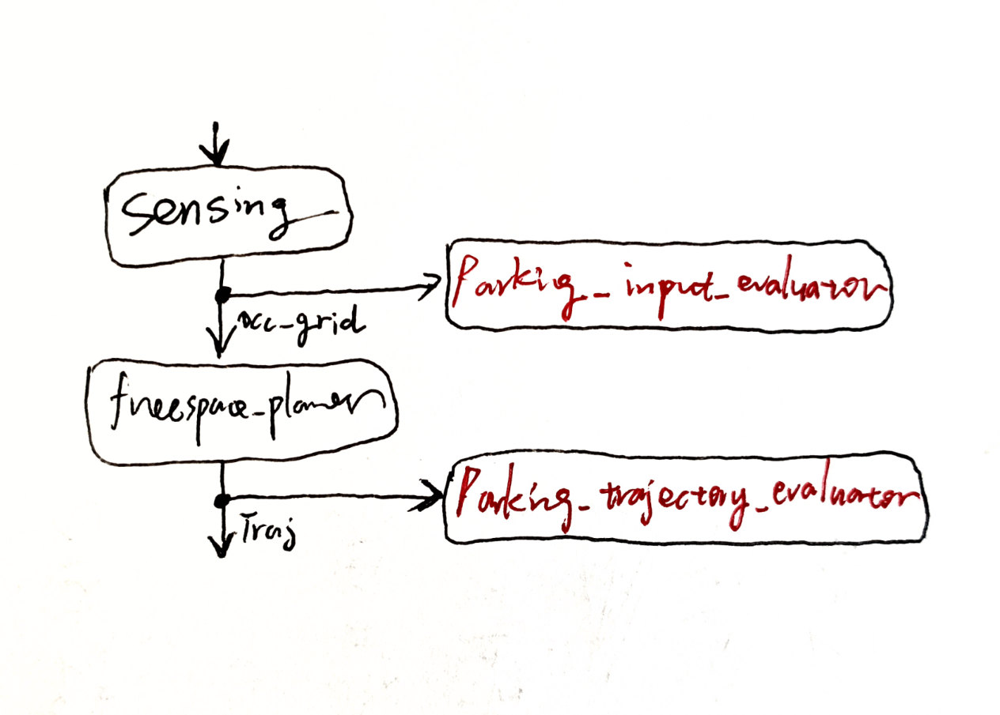

# 泊车规划评估工具链

> 目标版本：ROS 2 Humble + Autoware 2.1.0
> 用途：对autoware泊车规划器freespace_planner输入和输出进行评估



针对 Autoware 2.1.0 `autoware_freespace_planner` 的两个**只读**评估节点：

| 节点 | 评估对象 | 核心输出 |
| --- | --- | --- |
| `parking_input_evaluator` | 规划器的**输入**（grid / route / odom / scenario / TF） | `is_input_ready`、`can_plan_current_goal` |
| `parking_trajectory_evaluator` | 规划器的**输出**（`parking/trajectory`） | `is_control_ready`、`total_score` |

两者都不发布任何控制指令、不修改轨迹、不与规划器争抢话题，可随时挂载或摘除。

---

## 1. 为什么需要

Autoware 自带的验证模块只覆盖输出侧：

- `planning_validator`：只检查轨迹本身的通用约束；
- `planning_evaluator`：指标默认面向车道规划，无泊车专用项。

而实际调试中，泊车失败的现象高度同质——planner 只输出一句 `Failed to find path`，看不出是哪一环不合格。实测归纳出：

| 现象 | 实际根因 | 原生模块能否发现 |
| --- | --- | --- |
| goal 在栅格外，A* 报无解 | `grid_length` 小于停车场跨度 | 不能 |
| goal 在栅格内仍无解 | 车位过窄 + 标线点云侵蚀 | 不能 |
| 栅格正常但忽然不规划 | scenario 不是 Parking，costmap 未激活 | 不能 |
| 偶发失败，重试就好 | 栅格更新慢 / 位姿与 goal 不同步 | 不能 |
| 规划有输出但控制跟不上 | 曲率超限、末端偏差、轨迹撞障 | 部分 |

前四类属于**输入侧**问题，可在规划前用纯几何判定；第五类属于**输出侧**问题。两个节点正好对应这两侧。

---

## 2. 系统架构

```
                    ┌──────────────────────────┐
  occupancy_grid ──▶│                          │
  route          ──▶│  parking_input_evaluator │──▶ is_input_ready
  odometry       ──▶│  （23 项检查）             │    can_plan_current_goal
  scenario/TF    ──▶│                          │
                    └────────────┬─────────────┘
                                 │ 输入合格
                                 ▼
                    ┌──────────────────────────┐
                    │   freespace_planner(A*)  │
                    └────────────┬─────────────┘
                                 │ parking/trajectory
                                 ▼
                    ┌──────────────────────────┐
                    │ parking_trajectory_eval  │──▶ is_control_ready
                    │ （14 硬约束 + 8 项评分）    │    total_score
                    └──────────────────────────┘
```

---

## 3. 快速开始

### 3.1 构建

> **注意**：rosidl 在含中文的路径下会丢失路径片段（报错里出现 `/tools/build/...`）。
> 因此源码保留在 `~/桌面/tools/`，通过符号链接到 ASCII 工作区构建。

```bash
mkdir -p ~/parking_tools_ws/src
ln -sfn "$HOME/桌面/tools/parking_input_evaluator"      ~/parking_tools_ws/src/
ln -sfn "$HOME/桌面/tools/parking_trajectory_evaluator" ~/parking_tools_ws/src/

source /opt/ros/humble/setup.bash
source ~/autoware_2.1.0/install/setup.bash

cd ~/parking_tools_ws
colcon build --packages-select parking_input_evaluator parking_trajectory_evaluator \
  --cmake-args -DCMAKE_BUILD_TYPE=Release -DPYTHON_EXECUTABLE=/usr/bin/python3

source install/setup.bash
```

依赖：ROS 2 Humble、`autoware_planning_msgs`、`autoware_map_msgs`、
`autoware_internal_planning_msgs`、OpenCV、Eigen3、tinyxml2、tf2。

### 3.2 运行

```bash
# 终端 1：输入评估
ros2 launch parking_input_evaluator parking_input_evaluator.launch.xml \
  use_sim_time:=true

# 终端 2：轨迹评估
ros2 launch parking_trajectory_evaluator parking_trajectory_evaluator.launch.xml \
  use_sim_time:=true
```

### 3.3 查看结果

```bash
# 输入侧
ros2 topic echo /planning/evaluation/parking_input_report --field is_input_ready
ros2 topic echo /planning/evaluation/parking_input_report --field failure_reasons

# 输出侧
ros2 topic echo /planning/evaluation/parking_trajectory_report --field is_control_ready
ros2 topic echo /planning/evaluation/parking_trajectory_report --field total_score

# 统一诊断
ros2 topic echo /diagnostics | grep -A6 parking_
```

RViz 中分别添加两个 `MarkerArray`：

- `/planning/evaluation/parking_input_marker`：栅格范围、盲区、车位染色（绿可停/红碰撞/灰盲区）、goal 箭头；
- `/planning/evaluation/parking_trajectory_marker`：轨迹染色（绿可控/红不可控）、蓝色倒车段、终点箭头。

---

## 4. 两个节点

### 4.1 parking_input_evaluator

**23 项检查，分 7 组**，每项给出实测值、阈值和修复建议：

| 组 | 内容 | 项数 |
| --- | --- | --- |
| A | 栅格本体：频率、元数据、覆盖率、值分布 | 4 |
| B | 目标：在栅格内、可通行、可放车、朝向一致 | 5 |
| C | 起点：频率、可放车、与 route 起点一致 | 4 |
| D | 场景：Parking 占比 | 1 |
| E | TF：`map → base_link` | 1 |
| F | 可规划性：拓扑连通、A* 等效连通、EDT 余量、车位可泊率 | 4 |
| G | 几何余量：车位宽/长、朝向离散化、栅格 vs 对角线 | 4 |

关键实现与 `astar_search.cpp` 严格对齐：

- 障碍判定 `cost < 0 || cost >= 100`（`abstract_algorithm.cpp:117-121`）；
- 搜索节点要求 EDT ≥ 半车宽（`astar_search.cpp:262`）；
- 碰撞形状 `length += margin`、`width += margin`，**只加一次**（`freespace_planner_node.cpp:442-445`）。

**F4「车位可泊率」是最有价值的产出**——直接把"这批车位里能停几个"变成可数的指标，并把失败原因分为
`OUT_OF_GRID`（扩大栅格）/ `BLOCKED`（过滤地面点或加宽车位）/ `UNREACHABLE`（通道被割裂）三类。

### 4.2 parking_trajectory_evaluator

**14 条硬约束 + 8 项加权评分（100 分）**：

硬约束：点数、NaN、点间距、曲率、转向角、转向角速率、速度、终点静止、朝向跳变、中心碰撞、外廓碰撞、末端横向/纵向/航向误差。

软约束：

| 项 | 权重 |
| --- | --- |
| 末端横向误差 | 20 |
| 末端纵向误差 | 15 |
| 末端航向误差 | 15 |
| 换向次数 | 15 |
| 最大横向加速度 | 10 |
| 最大横向 jerk | 10 |
| 最小障碍间隙 | 10 |
| 曲率方差 | 5 |

`is_control_ready = 无硬约束失败 AND total_score ≥ 70`。

---

## 5. 联合排查流程

```text
planner 报错或轨迹异常
        │
        ├─ is_input_ready = false
        │     └─ 修输入：扩 grid_length、调膨胀核、过滤地面点
        │        （看 failure_reasons 和 F4 车位明细）
        │
        └─ is_input_ready = true
              ├─ is_control_ready = true   → 链路正常
              └─ is_control_ready = false  → planner 输出质量问题
                    （看 failure_reasons：曲率 / 末端偏差 / 碰撞）
```

这样能把"规划失败"的责任清晰分到输入侧或输出侧，不再靠猜。

---

## 6. 实测结论（Town04 / session2）

### 输入侧

```text
PASS=19  WARN=2  FAIL=2
A3 覆盖率      53.7%（右缺 11.5 m、下缺 25.4 m）   FAIL
G4 栅格 vs 对角线 69.9 m vs 96.3 m                 FAIL
A1 栅格频率    4.14 Hz（期望 10 Hz）                WARN
F4 车位可泊率  27/35（77.1%）                       WARN
```

7 个不可停车位中：5 个落在栅格外的下侧盲区（y=181.4~192.4 < 栅格下界 196.05），
2 个车位内有贴边障碍带，扣除后可用宽度 1.99 m < 碰撞宽 2.057 m。

**结论**：当前 goal 能规划成功，但系统整体不具备稳定泊车能力——换到 y<196 的车位必然失败。

### 输出侧

| 场景 | is_control_ready | score | 失败原因 |
| --- | --- | --- | --- |
| 正常轨迹（0.5 m/s，终点 0） | true | 97.1 | — |
| 超速轨迹（3.0 m/s） | false | 97.1 | velocity exceeds the parking limit |

### 测试

| 包 | 单元测试 |
| --- | --- |
| `parking_input_evaluator` | 16 项 |
| `parking_trajectory_evaluator` | 23 项 |

合计 39 项，全部通过。

---

## 7. 设计要点与踩坑

### 7.1 地图必须读 `local_x / local_y`

本项目 OSM 是 VMB 导出格式，`lat/lon` 为空，坐标在标签里：

```xml
<node id="36777" lat="" lon="">
  <tag k="local_x" v="295.6794"/>
  <tag k="local_y" v="225.2732"/>
</node>
```

标准 lanelet2 parser 只读 `lat/lon`，会把所有点解析成 `(0,0)`——表现为车位长度 0、覆盖率 0%。
Autoware 靠 `AutowareOsmParser` 手动覆盖坐标（`lanelet2_map_loader.cpp:163`）。
`parking_input_evaluator` 为保持独立，直接用 **tinyxml2** 解析。

### 7.2 QoS 用 volatile 更兼容

`scenario`、`route` 若订阅成 `transient_local`，会与 rosbag2 的 volatile 发布者不兼容，
表现为"话题有数据但节点收不到"。统一用 `reliable + volatile` 即可兼容两种情况。

### 7.3 栅格来源可配置

`freespace_planner` 既可能订阅 `costmap_generator`，也可能改为订阅直接生成栅格的节点。
两个 launch 都暴露了 `occupancy_grid_topic`，切换来源无需改代码：

```bash
ros2 launch parking_input_evaluator parking_input_evaluator.launch.xml \
  occupancy_grid_topic:=/your/occupancy_grid_topic
```

### 7.4 分级函数语义

`classify(pass_ok, warn_ok)` 的第二个参数表示"满足 WARN 阈值"，不是"存在风险"。
写反会导致所有本应 PASS 的项被误判为 WARN。

---

## 8. 目录结构

```
tools/
├── README.md                              # 本文件
├── 泊车规划数据录制与回放 操作手册.md      # 数据采集流程
├── OccupancyGrid 消息解析.md               # 栅格字段说明
├── parking_input_evaluator/
│   ├── parking_input_evaluator.md         # 开发文档（设计稿）
│   ├── README.md                          # 使用说明
│   ├── include/parking_input_evaluator/   # 7 个头文件
│   ├── src/                               # 6 个实现文件
│   ├── msg/  srv/                         # 3 消息 + 1 服务
│   ├── config/  launch/
│   └── test/                              # 3 个测试文件
└── parking_trajectory_evaluator/
    ├── parking_trajectory_evaluator.md    # 开发文档（设计稿）
    ├── README.md
    ├── include/parking_trajectory_evaluator/
    ├── src/
    ├── msg/  srv/
    ├── config/  launch/
    └── test/
```

---

## 9. 后续工作

1. **阈值校准**：用 CARLA 实跑的真实泊车轨迹校准 `max_curvature`、`min_score`、舒适性阈值；
2. **goal 自动同步**：轨迹评估节点的 `goal` 目前是配置参数，可改为订阅 `route.goal_pose`；
3. **在线监控节点**：把输入侧 23 项、输出侧 22 项检查合并成一个轻量监控节点，持续输出 `/diagnostics` 告警；
4. **输入侧修复验证**：按 `grid_length → 110`、`minimum_lidar_height_thres → 0.15` 调整后重跑，
   期望 F4 从 27/35 提升到 35/35。
